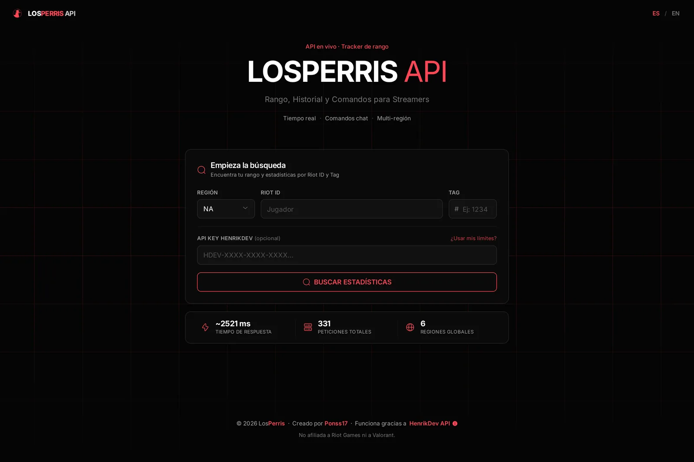
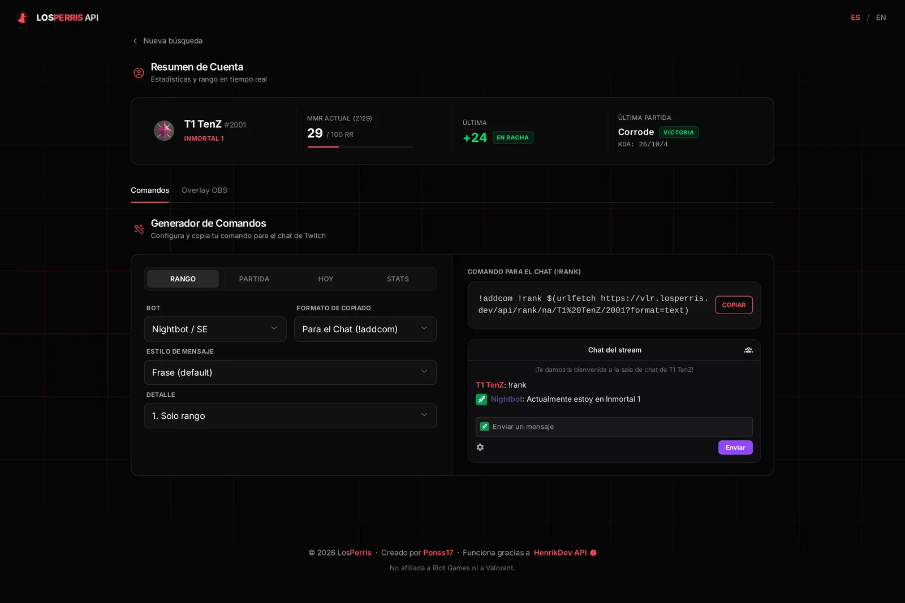
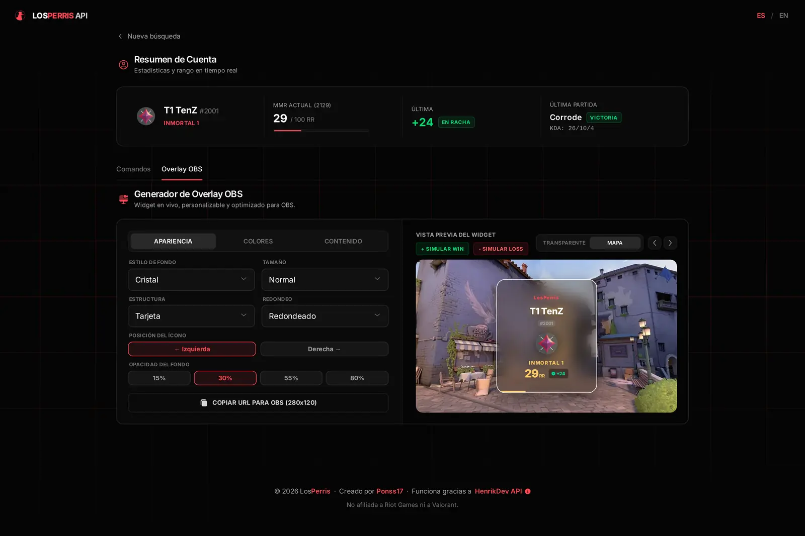
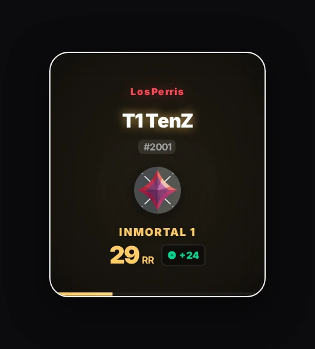
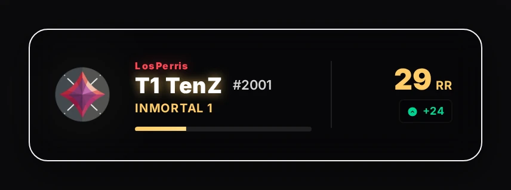

# LosPerris Valorant API

Stats de Valorant para streamers: rango, última partida, sesión del día, comandos para bots de Twitch y overlay para OBS.

**Sitio:** [https://vlr.losperris.dev](https://vlr.losperris.dev)

Usa datos de [HenrikDev](https://henrikdev.xyz/). No afiliada a Riot Games ni a Valorant.

<div align="center">
  
</div>

---

## Cómo usarlo (panel)

1. Entra a [vlr.losperris.dev](https://vlr.losperris.dev)
2. Elige región, escribe tu Riot ID y tag, y busca
3. En **Comandos**, elige plataforma (Nightbot / Fossabot / StreamElements), estilo y detalle
4. Copia el comando y pégalo en tu bot
5. En **Overlay OBS**, personaliza el widget, copia la URL y añádela como fuente de navegador en OBS

También puedes poner tu propia API key de HenrikDev en el buscador si quieres usar tus límites en lugar de la cuota compartida.

<div align="center">
  
  <br />
  <em>Resultado de un jugador público (T1 TenZ#2001) y generador de comandos</em>
</div>

Guía rápida de comandos: [vlr.losperris.dev/docs](https://vlr.losperris.dev/docs)

---

## API

Base: `https://vlr.losperris.dev`

Regiones: `na`, `eu`, `ap`, `kr`, `latam`, `br`.

### Query opcionales

| Param | Descripción | Valores |
|-------|-------------|---------|
| `format` | Respuesta para bots | `text` (omitir = JSON) |
| `lang` | Idioma | `es` (default), `en` |
| `type` | Detalle del texto | `1` → `3` |
| `style` | Estilo del mensaje | `default`, `clean`, `custom` |
| `template` | Plantilla si `style=custom` | p. ej. `Rango: {rank}` |
| `api_key` | Tu key de HenrikDev | opcional |

### Endpoints

```
GET /api/rank/:region/:name/:tag
GET /api/match/last/:region/:name/:tag
GET /api/today/:region/:name/:tag
GET /api/stats/:region/:name/:tag
GET /api/summary/:region/:name/:tag
GET /api/overlay/:region/:name/:tag
GET /api/system/stats
```

**Rango (`type`):**
- `1` → solo rango
- `2` → rango + RR
- `3` → rango + RR + MMR

**Última partida (`type`):**
- `1` → mapa + agente + resultado
- `2` → + KDA
- `3` → + HS%

**Hoy (`type`):**
- `1` → W / L
- `2` → + partidas
- `3` → + winrate

**Stats (`type`):**
- `1` → compacto
- `2` → básico
- `3` → descriptivo

`/api/summary` devuelve JSON con cuenta, rango, última partida e historial.

---

## Bots de Twitch

<div align="center">
  
</div>

### Nightbot / StreamElements

```
$(urlfetch https://vlr.losperris.dev/api/rank/na/NombreJugador/TAG?format=text&lang=es&type=1)
```

### Fossabot

```
$(customapi https://vlr.losperris.dev/api/rank/na/NombreJugador/TAG?format=text&lang=es&type=1)
```

### Estilos

| style | Ejemplo |
|-------|---------|
| `default` | `Actualmente estoy en Oro 3` |
| `clean` | `Oro 3` |
| `custom` | Tú defines el texto con variables |

Variables útiles:
- rank: `{rank}` `{rr}` `{mmr}` `{name}` `{tag}`
- match: `{map}` `{agent}` `{result}` `{rr}` `{kda}` `{hs}`
- today: `{wins}` `{losses}` `{rr}` `{winrate}`
- stats: `{winrate}` `{agent}` `{hs}` `{matches}`

```
?format=text&style=clean
?format=text&style=custom&template=Rango:%20{rank}%20({rr}%20RR)
```

---

## Overlay OBS

<div align="center">
  
  <br />
  <em>Personaliza el widget y copia la URL para OBS</em>
</div>

1. Busca tu cuenta en el panel → pestaña **Overlay OBS**
2. Ajusta layout, fondo y qué mostrar
3. Copia la URL
4. En OBS: **Fuente → Navegador** → pega la URL  
   Tamaño orientativo: ~280×120 o ~380×100 según el layout

<p align="center">
  
  &nbsp;&nbsp;
  
  <br />
  <em>Layouts tarjeta y banner (capturas a tamaño nativo del widget)</em>
</p>

---

## Licencia

ISC © [Ponss17](https://github.com/Ponss17)
